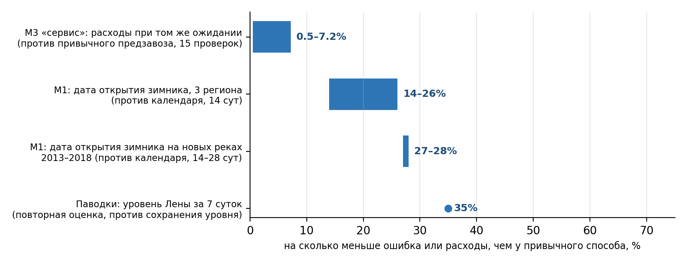

# Польза «Окна завоза» в цифрах

Сводка проверена при интеграции ZXC 13.11.2026. Это архивные и сценарные проверки;
паводковые модели повторно оценивались на ранее изучавшемся архиве. Каждая цифра относится к выборке своего отчёта. Подробная сводка доказательств —
[reports/evidence_summary.md](../reports/evidence_summary.md), журнал всех проверок — [DEVLOG.md](DEVLOG.md).

## Польза на примерах: о чём конкретно идёт речь

**Пример 1. Завоз в Якутск через Лену, весна 2019 (реальные даты, реальные цены).**
Ледовая переправа Якутск — Нижний Бестях закрылась 15 апреля, паром пошёл 25 мая — 40 суток без штатного пути.
Склад в Якутске выдаёт 25 т в сутки; груз идёт хаб → ж/д (11 003 ₽/т) → Нижний Бестях → переправа → склад.
- **Как планируют сейчас (предзавоз по календарю):** расходы на перевозку и хранение **38,50 млн ₽**, получатель ждал груз **2 338 т·сут**.
- **Сервис, то же ожидание:** **36,84 млн ₽ — на 1,66 млн ₽ (4,3%) дешевле.**
- **Сервис, вдвое меньше ожидание (1 141 т·сут):** 38,63 млн ₽ — всего +0,3% к привычной схеме.
- **Почему так:** оптимизатор завозит заранее ровно столько, сколько нужно, и держит груз на дешёвом складе
  (22 ₽ за тонну в сутки) вместо того, чтобы в распутицу везти его судном на воздушной подушке (25 000 ₽/т)
  или заставлять людей ждать.
- Отчёт: [real_prices_check](../reports/real_prices_check.md); в дашборде — вкладка «Сквозной коридор (А3)», режим «сервис».

**Пример 2. Водитель перед рейсом по переправе Якутск, весна 2026 (реальные приказы).**
Дата решения 16 марта, машина 12 т пустая.
- Рейс **3 апреля** с 6 т груза: действует предел 30 т — превышения нет; риск весеннего закрытия к этой дате 21,8%.
  **Сервис советует выехать 1 апреля — риск 12,9%.**
- Рейс **10 апреля** с 12 т груза (24 т полной массы): с 8 апреля предел 20 т — **«снизить груз минимум на 4 т»**.
- Рейс **16 апреля**: переправа закрыта с 15 апреля — **совет ехать 9 апреля**.
- Каждый ответ — со ссылкой на официальное сообщение. Вкладка «Риски и рекомендации».

**Пример 3. Высокая вода на Лене у Якутска, май 2020.**
9 мая сервис дал **67%** вероятности высокой воды на 16 мая — **за 7 суток**. Правило «уровень не изменится» давало 6%,
«как обычно в эти дни» — 1%. Уровень достиг выбранной статистической отметки; затопление дороги этим не подтверждено. В целом по 46 дням с высокой водой на Лене (2019–2023) сервис предупредил
**раньше** простого правила в **26** случаях, одновременно — в 12, позже — в 8; средний запас времени **4,8 суток против 4,0**.
Отчёт: [flood_day_efficiency](../reports/flood_day_efficiency.md); направление «Паводки».

**Пример 4. Куда вкладывать перед распутицей.**
На тех же трёх реальных сезонах: если добавить 10% мощности резервной переправы через Лену (судно на воздушной подушке),
ожидание получателя падает на **9–10%**; если добавить 10% железной дороги — **не меняется вовсе**.
В этом сценарии резерв через Лену сильнее влияет на ожидание; вывод не переносится автоматически на весь регион. Отчёт: [zxc_value](../reports/zxc_value.md).

## 1. Польза по частям

| Часть | С чем сравниваем | Результат | Насколько надёжно | Отчёт |
| --- | --- | --- | --- | --- |
| **М3 — оптимизатор, режим «сервис»** | привычный предзавоз по календарю, те же даты и цены | при том же ожидании получателя расходы **−0,5…−7,2%** в 14 из 15 проверок (медиана −5,2%); вдвое меньше ожидание — от −2,1% до +5,1% | реальные даты переправы 2019, 2023, 2024; 5 реальных вариантов цен хранения | [real_prices_check](../reports/real_prices_check.md) |
| М3 в рублях | то же | **0,6–2,75 млн ₽** на 3 000 т за сезон (**200–920 ₽/т**); исключение — топливо 2024 г. (+0,26 млн ₽) | спрос и мощности коридора — допущения | [real_prices_check](../reports/real_prices_check.md) |
| Диагностика узкого места | +10% каждой мощности по очереди | резерв через Лену (СВП): ожидание **−8,9…−9,7%**; штатная переправа −4,7…−4,8%; **железная дорога — 0%** | те же 3 сезона | [zxc_value](../reports/zxc_value.md) |
| **М1 — дата открытия зимника** | средняя дата прошлых 10 лет | ошибка за 14 сут **−14%** (Якутия), **−26%** (Красноярский край), **−25%** (Иркутская обл.) — это 2–4,5 сут | бутстрэп по сезонам, интервалы выше нуля | [m1_significance](../reports/m1_significance.md) |
| М1 на новых реках после 2012 г. | календарь с той же поправкой «ещё не открылось» | **−27%** за 14 сут, **−28%** за 28 сут; за 7 сут — на уровне календаря | 19 постов, 6 сезонов вне обучения | [new_gauges](../reports/new_gauges.md) |
| М1 — закрытие переправы Якутск | календарь | **−17%** за 14 сут; на постах — на уровне календаря | бутстрэп, интервал 5…28% | [m1_significance](../reports/m1_significance.md) |
| Толщина льда без замеров | бюллетени УГМС | **17 из 20** в диапазоне, ошибка 10,3 см | только строки с подтверждённым источником | [ice_bulletins](../reports/ice_bulletins.md) |
| **М2 — лёд или вода по радару** | — (календарь этого не видит) | точность **0,95** | 1 127 снимков, годы вне обучения | [m2_metrics](../reports/m2_metrics.md) |
| **Паводки — уровень Лены у Якутска за 7 суток** | «уровень не изменится» | MAE М1 v2 **39,9 против 61,4 см**, примерно −35% | повторная оценка 2019–2024, все доступные даты; отдельной метрикой половодья не является | [flood_m1_quantile](../reports/flood_m1_quantile.md) |
| Паводки — высокая вода на выбранные сутки | — | за сутки поймано **140 из 146** случаев; за неделю на Лене — 16 из 46 | повторная архивная оценка | [flood_day_efficiency](../reports/flood_day_efficiency.md) |
| Паводки — выделение воды по снимку | NDWI: IoU 0,758 | рабочий спектральный компонент: **IoU 0,781**, кандидат: **0,874** | 90 тестовых чипов Sen1Floods11 L1C; перенос кандидата на рабочие L2A-сцены не проверен | [flood_m2_benchmark](../reports/flood_m2_benchmark.md) |
| **Риски и рекомендации** | решение «на глаз» | проверка массы машины по реестру: пределы 30/20 т для **18 дорог**; советы «снизить груз на N т», «выехать раньше — риск ниже на N п.п.» | 213 записей реестра, каждая со ссылкой | [source_audit](../reports/source_audit.md) |

## 2. Что не дало пользы — и это тоже результат

| Что проверяли | Результат | Что сделали |
| --- | --- | --- |
| Прогноз официальных дат зимников (184 приказа) | не точнее «как в прошлом году» | где есть график — берём график, прогноз — как предупреждение |
| Прогноз даты как источник денег (весна 2026) | календарь дешевле на 8,6%; идеальное знание графика — лишь −0,2% | деньги даёт оптимизатор, а не точность даты |
| Ледоход у Якутска 2022–2026 | М1 3,03 сут против календаря 3,24 — на уровне календаря | не заявляем преимущество |
| Толщина снега, погодная модель GFS, дата ледостава со спутника | эффекта нет | выключены по умолчанию |
| Даты закрытия дорог при паводке методом аналогов | хуже календаря (10,8 против 5,3 сут) | в сервисе — календарный ориентир |
| Внешний прогноз расхода GloFAS | наводнение в Орске 2024 г. не поймал | только как внешний индикатор |

## 3. Суммарно: насколько сервис обгоняет старое планирование

Складывать проценты разных частей нельзя — они про разное (деньги, сутки, сантиметры). Честная сводка:

| Вопрос | Старый способ | С сервисом |
| --- | --- | --- |
| **Сколько стоит довезти** при том же сервисе для людей | предзавоз по календарю | **в среднем на 5% дешевле** (0,5–7,2%), 200–920 ₽ на тонну |
| **Сколько люди ждут груз** при тех же деньгах | как получится | **можно вдвое меньше** — расходы от −2,1% до +5,1% |
| **Когда откроется зимник** | средняя дата прошлых лет | ошибка **на 14–28% меньше** (на 2–4,5 сут), там, где нет графика |
| **Уровень Лены у Якутска** через 7 суток | сохранение уровня | MAE **39,9 против 61,4 см** на повторной архивной оценке; это не вероятность проезда |
| **Можно ли ехать** этой машиной в этот день | опыт водителя | ответ с источником: предел массы, риск по дате, совет |
| **Куда вложить** деньги перед распутицей | интуиция | расчёт: в резерв через Лену, а не в железную дорогу |

## 4. Субъективная оценка полезности

**Для оператора завоза — средняя, но реальная.** Около 5% расходов при том же сервисе — это не революция, а
нормальный выигрыш оптимизации. Ценнее другое: режим «сервис» впервые показывает, сколько стоит каждый день
ожидания получателя, и позволяет выбрать уровень сервиса осознанно, а не по привычке. Настоящий размер выигрыша
покажет только пилот на план-факте реального склада.

**Для перевозчика и водителя — высокая там, где опубликованы ограничения.** Проверка массы и риска по дате — простая,
понятная и с источником; её польза ограничена полнотой реестра (18 дорог с пределами массы).

**Для минтранса и МЧС — требуется пилот.** На повторной архивной оценке MAE уровня Лены у Якутска за 7 суток
примерно на 35% ниже сохранения уровня. Чувствительность логистического сценария указывает на резерв через Лену;
эффект на реальных рейсах ещё нужно проверить.

**Прогноз дат (М1) — полезен точечно.** Там, где нет официального графика (местные зимники, новые регионы, начало
сезона), он заметно точнее календаря; там, где график есть, график точнее — и сервис это учитывает.

**Итог:** проект доказал пользу оптимизатора и паводкового прогноза на реальных данных, честно показал, где прогноз
дат не помогает, и готов к пилоту. Главные открытые вопросы — цена дня ожидания получателя и план-факт реального ТЛЦ.
